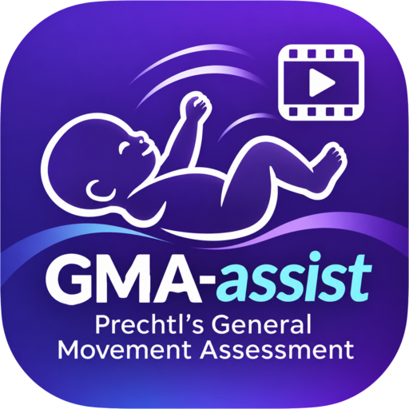

<p align="center"></p>

# GMA-assist

**Offline video review, scoring and training tool for Prechtl's General Movement Assessment (GMA).**

GMA Assist runs entirely in the web browser. It needs no installation, no server and no internet connection after the first load. Infant videos and records stay on the device.

> ⚠️ **Decision-support and education only.** GMA Assist does **not** classify general movements automatically and is not a medical device. GM classification must be made by an assessor trained in Prechtl's method (e.g. General Movements Trust Basic/Advanced courses). The motion indicators are exploratory.

---

## Features

### 1. Analyse video
- Open any local video file (MP4/MOV/WebM, depending on the browser). The file is never uploaded.
- **Muted by default**, because the manual recommends assessing without sound.
- Playback at 0.25×–4×, frame-by-frame stepping, ±5 s jumps and keyboard shortcuts.
- **Mark GM sequences** (start/end) and loop them for repeated viewing.
- **Region of interest (ROI):** draw a box around the infant to exclude caregivers, toys and monitors.
- **Exploratory motion analysis** (frame differencing on the ROI):
  - activity-over-time chart with automatically detected activity bouts (click the chart to jump to that moment)
  - per-limb image-quadrant activity (mapped from the head position you set)
  - left–right asymmetry, upper:lower ratio, inter-limb simultaneity and intensity variability
  - **observer prompts** (e.g. "high simultaneity — review for cramped-synchronised character"; "very little activity — check behavioural state")
  - one click turns the longest bouts into candidate GM sequences for review
- **Structured assessment form**
  - automatic corrected age (PMA / post-term weeks) from DOB, gestational age and recording date
  - selects the correct tool for the age period
  - recording-quality checklist (Chapter 3 standards)
  - global Gestalt classification: N, PR, CS, Ch, H / normal fidgety (++, +, +/−; D=P, D>P, P>D), AF, F−
  - **GM Optimality Score** (preterm and writhing; 8 items, max 16)
  - **Motor Optimality Score, 3–5 months** (Fig. 3.9; max 28) with N/A tick-lists for movement patterns, postural patterns and movement character. Items 3–5 are suggested automatically from the tallies.
  - print or save as PDF

### 2. Records & trajectory
- Saved assessments are drawn on the **individual developmental trajectory** chart (Fig. 3.7 layout: 26 weeks PMA to 22 weeks post-term).
- Prompts follow the manual's recommendations, e.g. a missing fidgety-period recording, repeating a recording when fidgety movements are absent, or repeated CS.
- Export and import records as JSON, or export them as CSV.

### 3. Learn
Ten modules: nine revision modules plus a reference video library. The revision modules cover why GMA, normal GMs across ages, co-existing movements at 3–5 months, abnormal GMs and their look-alikes (seizures, sepsis, drugs), recording technique, Gestalt assessment, optimality scores, trajectories, and clinical use.

### Reference video library (Learn → module 10)
- Openly published example recordings are embedded from YouTube (privacy-enhanced youtube-nocookie.com). They are not downloaded, and playing them needs internet.
- Built in: the four JAMA Network companion videos to Ferrari et al. 2002 (*Arch Pediatr Adolesc Med* 156:460–7): normal GMs, normal fidgety movements, cramped-synchronised GMs and abnormal fidgety movements.
- You can add more by pasting a YouTube link with its classification, source and a teaching note. These are saved on the device.

### 4. Quiz
A randomised bank of 25 multiple-choice questions, each with an explanation. The app keeps your best score.

### 5. Practice clips (training healthcare workers)
- **Trainer mode:** add de-identified teaching clips (a local video file **or a YouTube link**) with a reference (expert) classification, an optional reference score and teaching points.
- **Trainee mode:** score each clip blind, then see the reference answer and the teaching points.
- Per-trainee statistics: exact agreement, normal-vs-abnormal agreement, **Cohen's κ**, sensitivity and specificity against the reference, and a confusion matrix. Results export to CSV.
- Share a library across devices by exporting the **answer key (JSON)**. On the other device, import it and attach the video files; they are matched by file name.

### Other
- Session timer with a reminder after 45 minutes, as the manual advises a break.
- Installable as an app (PWA) and works offline.

---

## Deploy on GitHub Pages (free)

1. Create a new repository on GitHub, e.g. `gma-assist` (public, or private on a plan that allows Pages).
2. Upload all files in this folder to the repository root, keeping the folder structure (`index.html`, `css/`, `js/`, `icons/`, `sw.js`, `manifest.webmanifest`, `.nojekyll`).
   - In the browser: **Add file → Upload files**, then drag in the folder contents.
   - Or with git:
     ```bash
     git init && git add . && git commit -m "GMA Assist v1.0.0"
     git branch -M main
     git remote add origin https://github.com/<your-username>/gma-assist.git
     git push -u origin main
     ```
3. Go to **Settings → Pages → Build and deployment**. Choose **Source: Deploy from a branch**, **Branch: `main` / root**, then save.
4. After about a minute the app is live at `https://<your-username>.github.io/gma-assist/`.
5. On phones and tablets, open the link and choose **Add to Home Screen** (iOS) or **Install app** (Android/Chrome).

**Run locally without GitHub:** open `index.html` directly in Chrome, Edge or Firefox. Offline caching needs `http(s)`, so for the full PWA experience serve the folder, e.g. `python3 -m http.server`, then open `http://localhost:8000`.

**Updating:** when you change files, bump `CACHE` in `sw.js` (e.g. `gma-assist-v1.0.1`) so installed copies pick up the new version.

---

## Recording tips (summary of the manual, Chapter 3)
- Camera fixed high above the supine infant, with the whole body and face visible.
- Lightly dressed, arms and legs bare. For preterm infants, loosen the nappy and take the infant out of the nest.
- From 36 weeks PMA, record in active wakefulness. For younger infants, record during activity bouts.
- Avoid crying, drowsiness, hiccups, dummies, caregiver interaction, toys, mirrors and patterned blankets.
- Preterm: record 30–60 min and select about 3 GM sequences. From the writhing period on: 5–10 min of optimal recording.
- Do not record in the first 3 days after birth.

## How the motion indicators work
Each sampled frame from the ROI is reduced to 160×120 greyscale and compared with the previous sample. The app counts the pixels whose brightness changed by more than the pixel threshold, per image quadrant. Quadrants are mapped to limbs from the head position: with the camera above a supine infant whose head is at the top of the image, the infant's right side appears on the image left. The indicators are affected by lighting, camera shake, clothing, blankets and people entering the frame. They are designed to help find and document movement, **not** to judge complexity, variability or fluency.

## Privacy & data
- No analytics, no external requests, no cloud storage.
- Records are kept in `localStorage` and practice clips in `IndexedDB`, in the browser on that device only.
- Use pseudonymous infant IDs. Follow local consent and data-protection policies for infant video. Use **About → Delete all local data** on shared computers.

## Reference
Einspieler C, Prechtl HFR, Bos AF, Ferrari F, Cioni G. *Prechtl's Method on the Qualitative Assessment of General Movements in Preterm, Term and Young Infants.* Clinics in Developmental Medicine No. 167. London: Mac Keith Press; 2004.

The optimality score proformas follow Figs 3.8 (Ferrari et al 1990, modified) and 3.9 (Einspieler & Bos, GM Trust 2001) of the manual. The teaching text is an original summary for revision and does not replace the manual or accredited training.

## License
Code: MIT (see `LICENSE`). Scoring instruments and the GMA method remain the intellectual property of their authors and the General Movements Trust.
